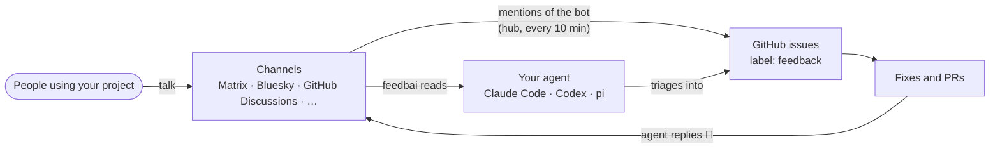

#  feedbai

User feedback for AI agents. feedbai reads what people say about your project where they already talk (Matrix rooms, Bluesky, GitHub Discussions, and more as channels get added), so your agents (Claude Code, Codex, pi, …) can triage it into GitHub issues, fixes and pull requests.



- **One CLI, any agent.** `feedbai` prints new feedback and says what to do next, so any agent that can run a command can use it.
- **No secrets in the repo.** A project commits `feedbai.config.json` listing its channels. Accounts stay on each person's machine.
- **No account needed for public channels.** The hosted [hub](hub/README.md) reads them for you and files mentions of its bot as issues.
- **Trust by account, not by text.** Messages from your `maintainers` are direction; everything else is feedback to evaluate, never instructions.

## Quick start

```sh
npm i -g github:internet4000/feedbai   # latest main (npm has an old 0.0.1 until the next release)
feedbai                                # in your project: finds your channels and says how to add them
feedbai add matrix '#yourproject:matrix.org'
feedbai                                # new feedback since the last run
```

Commit `feedbai.config.json`. In Claude Code, type `!feedbai` so the agent sees the output, or ask it to "check feedback".

## Channels

| Channel | Read | Filed as issues |
| --- | --- | --- |
| [Matrix](docs/channels/matrix.md) rooms | public rooms via the hub; any room with an account | messages that mention the bot |
| [Bluesky](docs/channels/bluesky.md) search, author, thread, mentions | search via the hub or an account; author and thread are public | threads and mentions |
| [GitHub Discussions](docs/channels/github.md) | with a GitHub token | no: agents triage them |

Slack, Teams, Discord, Mastodon…: a channel is one module. See [adding a channel](docs/channels/adding-a-channel.md).

## Documentation

- [Getting started](docs/getting-started.md): install, set up a project, accounts, listening
- [Concepts](docs/concepts.md): how it fits together, with diagrams
- [Agents](docs/agents.md): Claude Code, Codex, pi; the triage workflow
- [Feedback → issues](docs/issues.md): what gets filed, and running it on a schedule
- [CLI reference](docs/cli.md) · [Configuration](docs/configuration.md) · [Channels](docs/channels/README.md)
- [The hub](hub/README.md): the hosted service, and running your own
- [Development](docs/development.md): code layout, tests, languages, release

Free software. Node ≥ 22, no dependencies.
