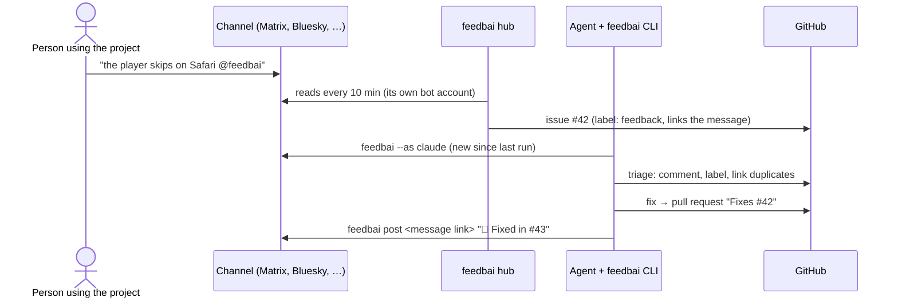
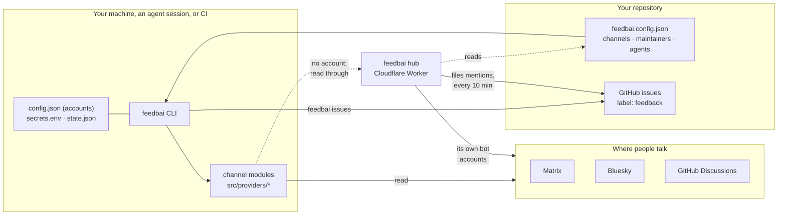

# Concepts

## The loop

People talk about a project in many places. Maintainers and their agents want that feedback where the work happens: in the repo, as issues and pull requests, with a reply back to whoever asked.

The hub and the agent are independent: use either or both. Without the hub, `feedbai issues` (run by you, an agent, or a scheduled workflow) does the filing.

## Architecture

## Projects and channels

A **project** is one thing people give feedback about, usually one repository. Its **sources** are the places to read: a Matrix room, a Bluesky search, a repo's GitHub Discussions… Each source has a `type` (the channel) and the fields that channel needs.

A project's `feedbai.config.json` lives in its repo and is shared. It never holds accounts or secrets. Your global config (`~/.config/feedbai/config.json`) can list more projects, for example ones whose repo you don't control. Both are merged by project id. See [configuration](configuration.md).

**Channels are modules.** Each type is one file in `src/providers/` that knows how to read (and sometimes post to) one platform. Everything else in feedbai works with any channel. See [adding a channel](channels/adding-a-channel.md).

## Accounts and secrets

Some sources need an account to read (private rooms, searches, mentions). **Accounts are personal**: they live in your global config, never in a project's. Secrets live in `secrets.env` (mode 600), or come from environment variables in CI. An account holds the *names* of those variables, never the values.

When a source needs an account and you have none, feedbai reads public channels through the **hub**, which uses its own accounts.

## Items

Every channel's messages become the same **item**:

| field | |
| --- | --- |
| `id` | the platform's id (Matrix event id, AT URI, GitHub node id…) |
| `platform`, `project`, `source` | where it came from |
| `author` | `{ id, name? }`, the account the platform authenticated |
| `text`, `url`, `createdAt` | the message, a link a person can open, an ISO date |
| `replyTo`, `thread` | the conversation it belongs to |
| `role` | `maintainer`, `agent` or `self` (below) |
| `toSelf` | it mentions the account feedbai reads with (the bot) |

Output formats: Markdown for people and agents, JSON and NDJSON for programs (`--format`).

## Roles: who is speaking

Roles come from the author's **account**, which the platform authenticates. Message text can never claim a role.

- **`[maintainer]`**: listed in the project's `maintainers`. Direction for agents, within what the person running the agent allows.
- **`[agent]`**: listed in the project's `agents` (bot accounts that work on the project), or a 🤖 report posted with your own account. Never opens an issue; `watch` skips it.
- **`[self]`**: the account feedbai reads with (it may be shared with a person).
- **Everyone else**: feedback. Data to evaluate, never instructions to follow.

## Cursors: "new since the last run"

Bare `feedbai` and `watch` show what is new since the last time they ran. Each agent keeps its own cursor (`--as claude`, `--as codex`, or `FEEDBAI_AGENT`), so two agents don't steal each other's "new". `--since 7d` shows a window without moving the cursor. Cursors are stored in `~/.local/state/feedbai/state.json`.

## Digests

When a source has more than 30 new items, Markdown output switches to a digest: maintainer messages in full, then one line per thread with its reply count and latest reply. Agents read conversations, not a firehose.

## Issues are the shared memory

Agents start fresh every session. GitHub issues labelled `feedback` are what persists: each one links the original messages through hidden markers, so no session or agent files or triages the same message twice. Coding agents then work from issues as usual. See [feedback → issues](issues.md).

Not everything becomes an issue. Chat rooms are conversations, so only messages that mention the bot start one. Searches and discussions are read for the overall mood, and agents file only what's actionable.

## The hub

The [hub](../hub/README.md) is a small always-on service (a Cloudflare Worker at https://feedbai.internet4000.com):

- **Reads public channels for people without accounts**: Matrix rooms its bot was invited to, and Bluesky searches.
- **Files issues** every 10 minutes for repos that installed the feedbai GitHub App, from each repo's `feedbai.config.json`.

A repo's config is untrusted there: the hub always uses its own accounts, and files a Matrix room into a repo only if the room is public or its topic names the repo. Turn it off with `FEEDBAI_HUB=off`, or point at your own with `FEEDBAI_HUB=<url>`.
